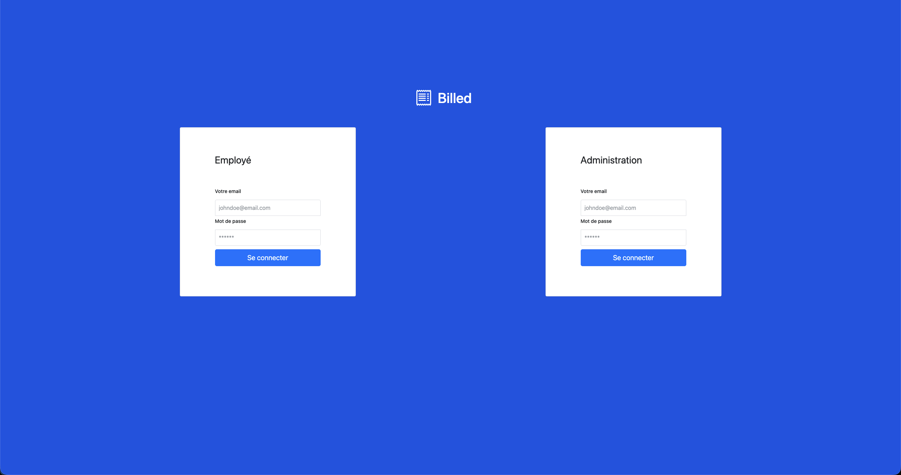

<h1 align="center">Billed</h1>

<p align="center"><strong>Languages:</strong> <a href="README.md">English</a> | <a href="README.fr.md">Français</a></p>

<p align="center">
  <a href="https://steinshy.github.io/OC-Billed/"><strong>Live demo →</strong></a>
</p>

<p align="center">
  
</p>

Expense report SPA built for the OpenClassrooms front-end path: employees submit expense reports with a receipt, administrators accept or refuse them. The project focus is debugging an existing codebase and covering it with tests.

## Live demo

The demo runs without a backend: an in-browser demo store (`src/app/DemoStore.js`) answers the same routes as the Express API.

| Role     | Email               | Password   |
| -------- | ------------------- | ---------- |
| Employee | `employee@test.tld` | `employee` |
| Admin    | `admin@test.tld`    | `admin`    |

Bills you create and admin decisions are kept in the tab's `sessionStorage`; closing the tab resets the demo.

## Features

- Employee and admin sign-in, sign-out
- Employee: list of their expense reports, receipt preview, new report with image upload (jpg, jpeg, png)
- Admin: dashboard grouped by status, accept or refuse with a comment

## Tech stack

| Area     | Stack                                                    |
| -------- | -------------------------------------------------------- |
| Frontend | Vanilla JavaScript (ES modules), Bootstrap 4, jQuery     |
| Backend  | Express 5, Sequelize, SQLite, JWT, Multer                |
| Tests    | Jest, Testing Library (jsdom), Supertest                 |
| Tooling  | pnpm workspace, ESLint, Stylelint, Prettier, live-server |

## Getting started

Requires Node.js 24 and pnpm (`corepack enable` picks the version pinned in `package.json`).

```bash
git clone https://github.com/Steinshy/OC-Billed.git
cd OC-Billed
pnpm install
pnpm dev   # API on :5678 (migrated and reseeded at start) + frontend on :8080
```

To try the frontend without the backend, run `pnpm dev:frontend` and open `http://127.0.0.1:8080/?demo`.

API reference: [Backend/README.md](./Backend/README.md).

## Scripts

| Command             | Purpose                                          |
| ------------------- | ------------------------------------------------ |
| `pnpm dev`          | Backend + frontend                               |
| `pnpm dev:frontend` | Frontend only (live-server)                      |
| `pnpm dev:backend`  | Backend only (migrations, then API on :5678)     |
| `pnpm seed`         | Migrations + demo data                           |
| `pnpm test`         | Frontend tests with coverage, then backend tests |
| `pnpm lint`         | ESLint + Stylelint + Prettier check              |
| `pnpm fix`          | Auto-fix ESLint, Stylelint and Prettier issues   |

## Deployment

Both targets serve the source files as-is (no bundler) and no backend: the demo store turns itself on outside localhost.

- **GitHub Pages:** `.github/workflows/deploy.yml` publishes on every push to `main`.
- **Coolify:** the `Dockerfile` serves the same files with nginx.

## Documentation

- [ARCHITECTURE.md](./ARCHITECTURE.md): structure and decisions
- [Backend/README.md](./Backend/README.md): API, database and demo accounts
- [`deliverables/`](./deliverables): test reports and the employee E2E test plan
